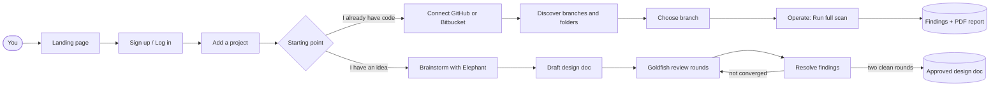
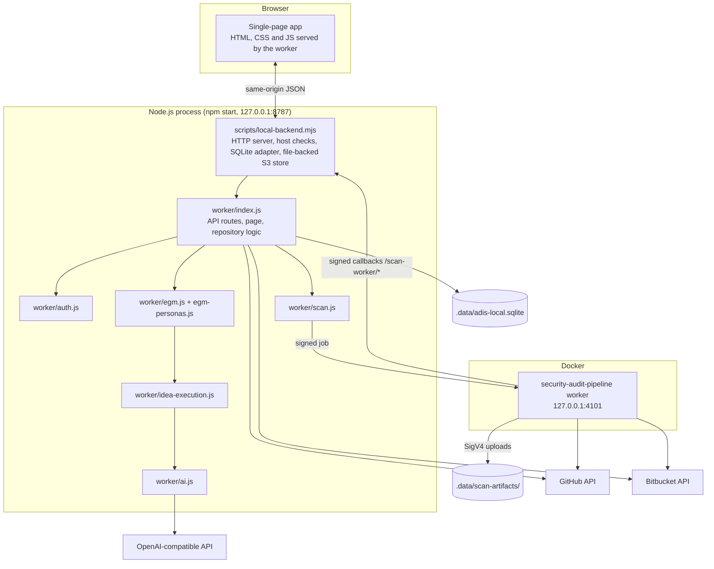
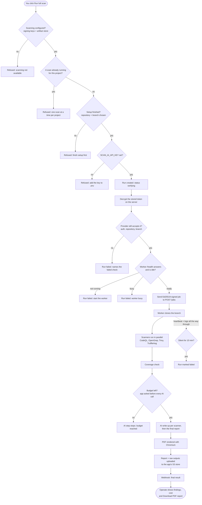
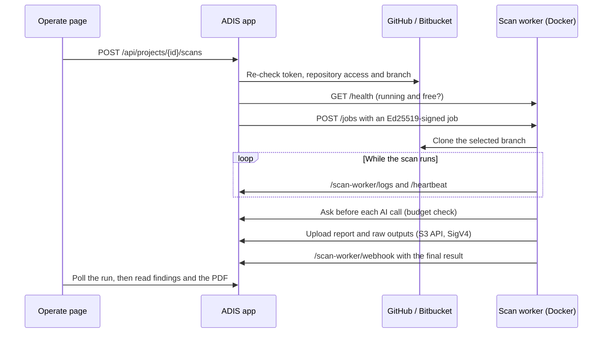
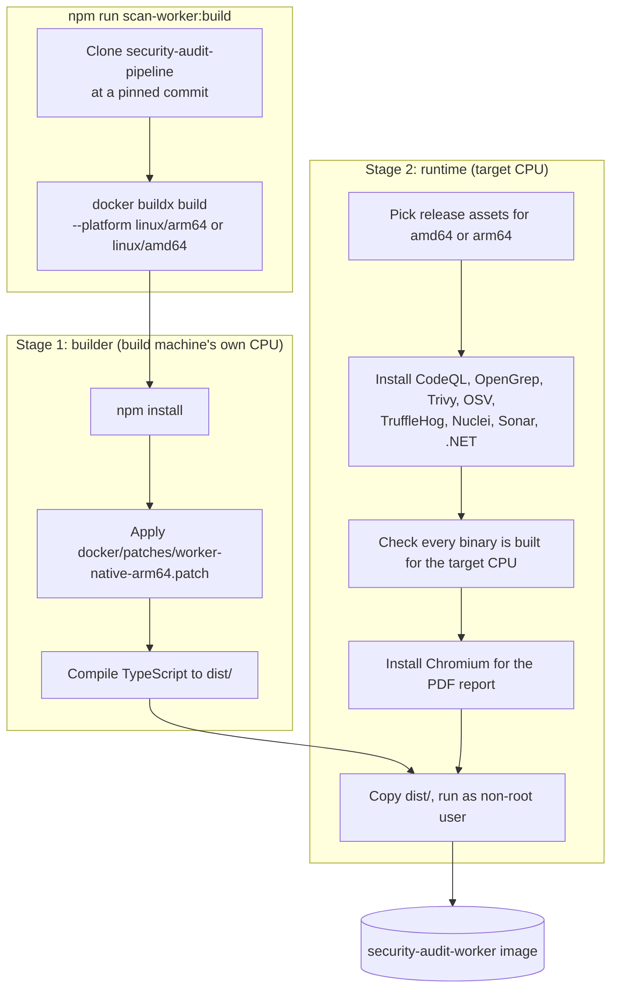
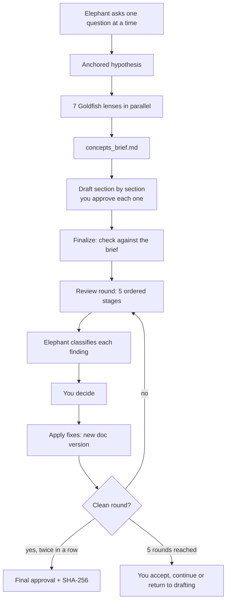
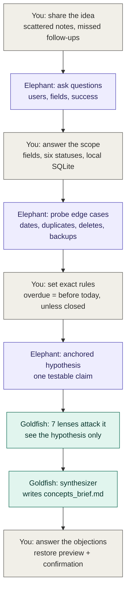
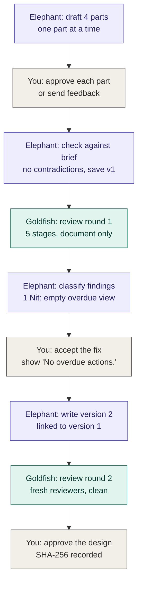

# ADIS Project Hub

ADIS Project Hub is a local web application for starting and checking software projects. A project begins in one of two ways. If the code already exists, you connect its GitHub or Bitbucket repository, choose a branch, and run a full security audit that ends in a PDF report. If only an idea exists, the Elephant–Goldfish workflow turns it into a reviewed and approved design document.

The interface and the API run in one Node.js process on `localhost`. All data is kept in a single SQLite file. The core app needs no `npm install`, no hosting platform and no cloud database. The security scanner is the one optional extra, and it runs in Docker on the same machine.



## Contents

- [Tech stack](#tech-stack)
- [Quick start](#quick-start)
- [Keys and credentials](#keys-and-credentials)
- [Using the app](#using-the-app)
- [Architecture](#architecture)
- [Path 1: existing code and the security audit pipeline](#path-1-existing-code-and-the-security-audit-pipeline)
- [The Docker scan worker](#the-docker-scan-worker)
- [Path 2: an idea and the Elephant–Goldfish workflow](#path-2-an-idea-and-the-elephantgoldfish-workflow)
- [Accounts and security](#accounts-and-security)
- [Data storage](#data-storage)
- [HTTP API](#http-api)
- [Configuration reference](#configuration-reference)
- [Project layout](#project-layout)
- [Testing](#testing)
- [Troubleshooting](#troubleshooting)
- [Branches](#branches)

## Tech stack

| Layer | Technology | Why it was chosen |
| --- | --- | --- |
| Runtime | **Node.js 22.9+**, ES modules | Ships a web server, crypto, file access and SQLite in the box, so the app needs no npm packages at all. |
| Server code | Plain JavaScript in the **Cloudflare Worker style** (`fetch(request, env)`) | The handler never touches files or databases directly, so the same code could be deployed to Cloudflare Workers later without a rewrite. Locally, `scripts/local-backend.mjs` plays the platform's part. |
| Database | **SQLite** through the built-in `node:sqlite` module, WAL mode | One file, no server to install, transactions and foreign keys. The adapter exposes the same `prepare / bind / batch` API as Cloudflare D1. |
| File storage | A small **S3-compatible store** built into the app (AWS Signature V4), writing to `.data/scan-artifacts/` | The scan pipeline was written for S3. Serving S3 locally avoids running MinIO or paying for a cloud bucket. |
| Interface | One HTML page with plain **HTML, CSS and JavaScript**, hash routes, Geist fonts from Google Fonts | No framework and no build step. The page is served by the same process as the API, so there is no CORS to configure. |
| Security | **AES-256-GCM** for repository tokens, **PBKDF2-SHA256** for passwords, **Ed25519**-signed scan jobs, strict CSP and same-origin checks | All from Node's built-in `crypto`. Details in [Accounts and security](#accounts-and-security). |
| Idea workflow AI | Any **OpenAI-compatible** chat API (default `gpt-4.1-mini`) | Works with OpenAI or any provider that speaks the same API. |
| Security scanner | The [security-audit-pipeline](https://github.com/ayushiii2707/security-audit-pipeline) worker (**TypeScript**, Node 20) in **Docker** | The scanners need many native tools (CodeQL, .NET, Java, Go binaries, Chromium). Docker keeps them off your machine and pins every version. |
| Scanners | **CodeQL, OpenGrep, Trivy, TruffleHog** (optional: OSV-Scanner, SonarQube, Dependency-Track, CycloneDX, Nuclei, ZAP) | Each covers a different kind of risk. See [the scanners](#the-scanners-and-why-each-one-is-used). |
| Scan report AI | **OpenAI Codex CLI** with `gpt-5-mini`, PDF rendered by **Puppeteer + Chromium** | Reads the merged findings, separates real issues from noise and writes the report. |
| Tests | Node's built-in **`node:test`** runner | No test framework to install. Integration tests start the real server on a temporary database. |

## Quick start

Node.js 22.9 or newer is required, because the server uses the built-in `node:sqlite` module. The project has no npm dependencies.

```bash
git clone https://github.com/ayushiii2707/ADIS-Autonomous-Development-Inspection-System.git
cd ADIS-Autonomous-Development-Inspection-System
npm start
```

Open <http://localhost:8787>. On the first start the server creates `.data/adis-local.sqlite`, applies every migration in `migrations/` and writes a credential encryption key to `.data/credential.key`. Later starts reuse both files.

`npm run dev` starts the same server and restarts it when files in `worker/` or `scripts/` change.

Settings are read from `.env` when that file exists. Copy `.env.example` to `.env` and fill in only what you need; the app starts without any of it.

## Keys and credentials

Four secrets can be supplied. Two are entered in the app's interface for each repository. The other two belong in `.env`.

| What | Where it goes | Needed for | How to get it |
| --- | --- | --- | --- |
| GitHub personal access token | App: Connect repository → GitHub | Connecting a GitHub repository and scanning it | GitHub → Settings → Developer settings → Personal access tokens. A fine-grained token needs **Contents: Read** on the repository. A classic token needs the `repo` scope. |
| Bitbucket API token (with your Atlassian email and Bitbucket username) | App: Connect repository → Bitbucket | Connecting a Bitbucket repository and scanning it | Atlassian account → Security → API tokens, with the **Bitbucket Repositories: Read** scope (`read:repository:bitbucket`). Legacy app passwords also work while Bitbucket still accepts them. |
| `AI_API_KEY` | `.env` | The Elephant–Goldfish idea workflow | Any OpenAI-compatible provider. The default endpoint is `https://api.openai.com/v1` with the model `gpt-4.1-mini`. |
| `SCAN_AI_API_KEY` | `.env` | The written report at the end of a security scan | An OpenAI API key. Scans stay disabled until it is set. |

Repository tokens are encrypted before they reach the database, and the two `.env` keys stay on the server. None of them is ever sent to the browser or written to a log. Restart the server after editing `.env`.

## Using the app

1. **Landing page.** The page opens with a 3D tunnel that shows the parts of the product. Scroll, or use the arrow keys, to move through it; the **Log in / Sign up** bar appears once you start scrolling.
2. **Sign up.** Enter a name, an email and a password of at least 8 characters. The first account on a fresh install also takes over any projects that were created before accounts existed.
3. **Add a project.** A popup asks for a project name and a short code, for example `AX-01`.
4. **Choose a starting point.** Two cards are shown: **I already have code** and **I have an idea**.
5. **Code path.** A five-step setup opens:
   1. **Connect sources:** pick GitHub or Bitbucket and enter the token. After **Check and add**, the app confirms the token can read that exact repository.
   2. **Repositories & branches:** choose the branch to scan from the live list.
   3. **Products:** say whether the repository is one product or several (a monorepo), give the product a name and pick its type (Web, Mobile, API, Database or Service). The type is a label; it does not change what the scan checks.
   4. **Sort your items:** choose whether repository issues come in and how each label is treated.
   5. **Review:** check the choices and finish.

   **Operate** then holds **Run full scan**, which shows live stages and logs while a scan runs and lists the findings with a PDF download when it finishes.
6. **Idea path.** Elephant asks one question at a time. When the idea is clear, it runs the brainstorm, drafts the design document section by section and sends it to independent Goldfish reviewers. You decide what happens to each finding.

The top bar stays the same everywhere. **Home** returns to the two starting points, **Discover** and **Operate** open those pages, and the project name has **Switch project** under it. Switch project lists all your projects with the active one first and has a **Create a new project** panel on the right.

**Deleting a project.** Each project card has a trash icon. The dialog lists what will be removed and asks you to type the project's code before **Delete project** turns on. Deleting removes the project's repository connection, setup, scan history, idea work, and its PDF reports and raw scanner outputs on disk. The repository on GitHub or Bitbucket is not touched. Only the project's owner can delete it, and not while one of its scans is running.

## Architecture



The code in `worker/` is written in the Cloudflare Worker style: one `fetch(request, env)` handler, with the database reached through `env.DB` and the artifact store through `env.SCAN_STORE`. `scripts/local-backend.mjs` provides both objects on top of local files, so the same handler runs on a laptop with nothing else installed. A worker with `node:sqlite` underneath keeps the dependency count at zero, which is why `npm start` works straight after cloning.

The page is one HTML document embedded in `worker/index.js`. It uses hash routes (`#/`, `#/signup`, `#/login`, `#/app`) and plain JavaScript, so there is no build step for the interface.

## Path 1: existing code and the security audit pipeline

### Connecting and discovering a repository

The connect form calls the provider before anything is saved. GitHub is checked with `GET https://api.github.com/repos/{owner}/{repo}` and Bitbucket with `GET https://api.bitbucket.org/2.0/repositories/{workspace}/{repo}`. A connection is stored only when the token can read that exact repository, which stops a typing mistake from being saved as a working connection.

Discovery then reads every branch and folder through the provider's official API, following all pagination, and caches the result in SQLite. Later page loads read the cache. Discovery can be repeated at any time from the Discover page. Setup accepts only a branch that discovery confirmed, so a scan cannot point at a branch that does not exist.

### Running a scan

The scanner is the separate [security-audit-pipeline](https://github.com/ayushiii2707/security-audit-pipeline) project, run as a Docker container. This app acts as its control plane: it checks the request, sends the job, receives progress and stores the results.

#### The Run scan workflow

Every check before the job leaves the app has its own error message, so a refused scan always says what to fix.



On a medium repository the scanners take a minute or two, each AI write-up one to two minutes, and the final report about three minutes, so a full scan usually ends in about 15 minutes. Large repositories can take 20–30 minutes.

The same exchange as messages between the parts:



The stages appear on the Operate page in this order.

1. **Verify.** The stored token is decrypted on the server and checked again against the provider. Authentication, access to the repository and the branch are all confirmed again, because a token can be revoked after it was saved. If any check fails, the job is not sent and the message names the failed check.
2. **Clone.** The worker clones only the chosen branch.
3. **Run scanners.** Each scanner described below runs against the checkout.
4. **Coverage check.** The worker compares the languages in the repository with the languages the scanners covered, so a gap in coverage is reported instead of being mistaken for a clean result.
5. **AI report.** A model reads the merged and de-duplicated findings, separates real issues from noise and writes the PDF report.
6. **Upload.** The report and every raw scanner output are uploaded to the app's artifact store.

The worker takes one scan at a time. A scan that sends no heartbeat for 10 minutes is marked as failed.

### The scanners and why each one is used

Each scanner looks at a different kind of risk, and their results overlap only in part. The default set is `codeql,opengrep,trivy,trufflehog`.

| Scanner | What it checks | Why it is in the set |
| --- | --- | --- |
| **CodeQL** | Builds a database of the source code and follows data through it, for example from a request parameter to an SQL query or a shell command. | It finds injection and data-flow bugs that cross several functions and files. Pattern matchers cannot see those paths, so CodeQL gives the deepest code analysis in the set. |
| **OpenGrep** | Matches the code against large rule packs of known insecure patterns, written for specific languages and frameworks. It is the open-source fork of Semgrep. | It is fast and covers frameworks, configuration files and languages that CodeQL does not model. Weak crypto calls, disabled TLS checks and unsafe framework options are typical results. |
| **Trivy** | Reads lockfiles and manifests for packages with known CVEs, and checks Dockerfiles and infrastructure files for misconfiguration. | Most of a modern project is third-party code. Trivy reports the vulnerable versions you depend on, together with the version that fixes each one. |
| **OSV-Scanner** (optional) | Matches dependencies against the OSV.dev database, which collects advisories from each language ecosystem. | Not in the default set, because Trivy already checks dependencies for known vulnerabilities. It is a second source: advisory databases differ, so two sources miss fewer issues, but it adds its own AI write-up to every scan. Add `osv` to `SCAN_SCANNERS` to use it. |
| **TruffleHog** | Searches the files and the full git history for secrets such as API keys, tokens and private keys, and can test whether a found key still works. | A key deleted in a later commit is still in the history. TruffleHog finds those keys and separates live keys from dead ones. |

Six optional scanners can be added through `SCAN_SCANNERS`; none of them runs unless it is listed there. OSV-Scanner is described above. SonarQube and Dependency-Track need their own servers. Nuclei and ZAP test a running web application, so they need a live URL. `bom-cyclonedx` produces a software bill of materials. A scanner that cannot run is recorded as skipped and the rest of the scan continues.

### How findings are assessed

Scanners report many items that are not real problems in context. For that reason, the report step sorts every finding into one of these groups: confirmed critical, high, medium or low; hardening (worth fixing but not exploitable as found); false positive; or not in report. The Operate page reads the same fixed sections of the report, so the list on screen matches the PDF. The scanner's own level, for example the SARIF level `warning`, is shown next to each finding but is not used as its severity. If the report step fails, the raw findings are still listed and marked as not assessed.

### AI cost limit

The pipeline asks the app before each AI call and reports the tokens used after it. The app keeps an estimated running cost for the scan and refuses new calls once it reaches `SCAN_AI_BUDGET_USD` (default `$2`). A call already in progress can go slightly past the limit. With `SCAN_AI_MODEL=gpt-5-mini`, a scan of a small-to-medium repository has cost about $0.15. The estimated cost of every run is shown on the Operate page.

### Why the scan link is built this way

The app signs each job with an **Ed25519** private key, and the worker holds only the public key. A leaked worker configuration therefore cannot be used to create jobs. Every token names its run and its scope (dispatch or callback) and expires after six hours, so a callback for one run cannot change another run.

The pipeline was written to upload results to S3. Instead of requiring MinIO or a cloud bucket, the app serves a small S3-compatible endpoint itself, checks the **AWS Signature V4** on every upload and writes the objects to `.data/scan-artifacts/`. The signing keys are created once under `.data/` with file mode 600 and reused, so a running worker keeps working after the app restarts.

## The Docker scan worker

The core app runs without Docker. Docker is needed only for security scans, because the scanners need native tools (CodeQL, a JDK, .NET, Go binaries, Chromium) that would otherwise have to be installed on your machine.

### Setting it up

Docker Desktop is needed, with about 25–30 GB of free disk space for the image.

```bash
npm run scan-worker:build    # once: builds the image for this machine's CPU
npm run scan-worker:start    # starts the worker on 127.0.0.1:4101, wired to this app
npm run scan-worker:status   # container state and /health
npm run scan-worker:logs     # recent worker logs
npm run scan-worker:stop     # removes the container (the image stays)
```

Then add the scan settings to `.env` and restart the app:

```bash
SCAN_AI_API_KEY=...
SCAN_AI_MODEL=gpt-5-mini
SCAN_AI_BUDGET_USD=2
```

### How the image is built



`scripts/scan-worker.mjs build` clones the [security-audit-pipeline](https://github.com/ayushiii2707/security-audit-pipeline) at one pinned commit, so a change in that repository cannot alter scans without a deliberate update here. It then builds `docker/scan-worker.Dockerfile` with `docker buildx` for this machine's CPU: amd64 on Intel and AMD, arm64 on Apple Silicon and other ARM machines. Set `SCAN_WORKER_PLATFORM=linux/amd64` or `linux/arm64` to build for the other one.

**Why this repository has its own Dockerfile.** The pipeline's own Dockerfile is amd64-only. On an Apple Silicon Mac it ran under emulation, where `codeql --version` and `opengrep --version` each took about 4 seconds. The worker checks that its scanners exist before accepting a job, gives each check 5 seconds, and ran the checks all at once, so under emulation they timed out and every scan was refused with "binary not found on PATH". Building natively makes the same checks finish in well under a second, and the scans themselves run several times faster.

**What the Dockerfile does:**

- **Two stages.** The TypeScript is compiled in a builder stage on the build machine's own CPU. The compiled JavaScript is the same for every target, and this avoids compiler crashes under emulation.
- **One patch** (`docker/patches/worker-native-arm64.patch`) is applied to the pipeline before compiling. It runs the readiness checks one at a time instead of all at once, so they never compete for CPU, and it passes the report browser's path through to the report step. The build fails if the patch does not apply cleanly.
- **Per-architecture downloads.** A table at the top of the runtime stage picks the right release file for each tool. Every downloaded binary is then checked: its ELF header must match the target CPU, and it must run.
- **Same versions as upstream**, with two exceptions forced by what is published for arm64. CodeQL moves to the 2.27.3 bundle on both architectures, because older bundles have no arm64 build. The PDF browser is Chrome for Testing on amd64 and Debian's Chromium on arm64, because Chrome for Testing has no Linux arm64 build. Both are reached through one wrapper, `/usr/local/bin/report-chrome`.
- **Emoji font** (`fonts-noto-color-emoji`) is installed so emoji in findings render in the PDF.
- **Small build context.** `docker/scan-worker.Dockerfile.dockerignore` sends only the worker's sources to Docker.
- **Non-root.** Scans run as the `worker` user. Builds that a scanner needs (for example CodeQL compiling C#) run as a separate `scanbuild` user.

| Tool in the image | Version |
| --- | --- |
| CodeQL bundle | 2.27.3 |
| OpenGrep | 1.1.0 |
| Trivy | 0.74.0 |
| OSV-Scanner | 2.6.0 |
| TruffleHog | 3.97.5 |
| Nuclei (+ templates) | 3.11.1 (templates 10.4.9) |
| Sonar Scanner CLI / for .NET | 6.2.1 / 6.2.0 |
| .NET SDK | 8.0 |
| Node.js (worker runtime) | 20 |

### How the container runs

`npm run scan-worker:start` starts the container `adis-scan-worker`:

- Its port is published on **`127.0.0.1:4101` only**, so nothing outside your machine can reach it.
- It reaches the app through `host.docker.internal`, which Docker maps to your machine.
- Its settings come from `.data/scan-worker.env` (file mode 600), written by the script: the app's callback address, the public key for checking job signatures and the S3 keys for uploads. The private signing key never leaves the app.
- It takes **one scan at a time**. The app checks `/health` before sending a job and refuses a scan while the worker is busy.
- If the image was built for a different CPU than this machine's, `start` prints a warning, because emulated scans are slow and the readiness check may fail.

## Path 2: an idea and the Elephant–Goldfish workflow

This path follows the [Elephant–Goldfish Model](https://github.com/google/elephant-goldfish-model) (Apache-2.0, see `NOTICE`): design with an Elephant and review with Goldfish. The Elephant is a planner that keeps the whole conversation and a structured memory. Each Goldfish reviewer starts with an empty context and sees only the document under review. A reviewer that knows the background tends to fill gaps from memory. A reviewer with no background has to rely on the page, so missing or unclear content is found before anyone builds from it. No repository is needed for this path.



**Brainstorm.** Elephant asks focused questions until the problem, the users, the outcome, the constraints and the success signal are clear. When you choose *Review with Goldfishes*, it writes an anchored hypothesis, and seven fresh lenses test it in parallel. The lenses are Contrarian/YAGNI; Cost, Quota and Token Economics; UX and Developer Ergonomics; Migration and Backward Compatibility; Observability and SRE Debuggability; Long-Term Tech Debt; and Inventive Catalyst. A synthesizer combines their output into `concepts_brief.md` and lists the strongest objections.

**Draft.** Elephant writes the design document from the brief in four parts: overview and user journeys, technical plan, alternatives, and a detailed implementation plan. You approve each part and can add feedback. Choices with more than one reasonable answer are shown as options for you to pick. Finalizing compares the draft with the brief and lists any contradiction before the document is saved.

**Independent review.** Each round runs five stages in order, with new reviewers for each: Zoom Out (with the Inventive Catalyst), Comprehension (the document alone), Design Critique, Intermediate Zoom Out and Implementation Readiness. Findings are rated Blocker, Major or Nit, merged and written to a Goldfish Review Report.

**Resolution.** For each finding Elephant proposes one of four actions: fix it, contest it with evidence the reviewer could have read, escalate it because only you know the answer, or decline it. You make the decision. A comprehension gap cannot be contested, since the reader's confusion is itself the evidence. Every Blocker and Major needs a decision before Elephant writes the accepted changes into a new document version linked to the previous one.

**Convergence.** A round is clean when every reviewer ran and no open Blocker or Major remains. Two clean rounds in a row end the review. After five rounds, or when fixes keep reopening issues, the choice to accept, continue or return to drafting is yours. Final approval records the SHA-256 hash of the approved text. Settled findings stay settled if a later reviewer raises them again.

Each Elephant and Goldfish call is a separate, stateless model request, stored as a durable execution with an idempotent enqueue, a claimed attempt, an input hash and an output hash. A failed reviewer is retried once and is then recorded as *not run*, and that round cannot count as clean. Before each Goldfish request is sent, the app checks it for a private marker that exists only in Elephant's context; if the marker is present, the request is not sent. Completed steps are reused, so a reload or a server restart continues from the last finished step. The concepts brief, each document version and each review report can be downloaded as Markdown.

`AI_MAX_CONCURRENCY` (default 4) limits how many model requests run at once. Set it to `1` on accounts with low per-minute token limits. Rate-limited requests wait for the provider's `Retry-After` and are retried.

### Worked example: a placement application tracker

This walks one small idea from first message to approval, showing who does what. There are three actors:

- **You** decide everything: scope, rules, which fixes to accept and final approval.
- **Elephant** remembers the whole conversation. It asks questions, drafts, checks the draft against the brief, sorts findings and applies fixes.
- **Goldfish** start with no memory and see only what they are handed. Anything that is not written down clearly, they catch.

The opening message: *"I want to build a personal placement application tracker. I keep applications in scattered notes and sometimes forget the next action."*

**Part 1: clarify and brainstorm.** The Elephant asks about the basics, then about edge cases you have not decided yet: does a date include a time, should duplicates be blocked, how do deleting and backups work. It turns your answers into one testable claim. Seven Goldfish lenses attack that claim while seeing nothing else, and a Goldfish synthesizer writes `concepts_brief.md` with the strongest objections. Your answers to those objections become rules the draft is later checked against.



**Part 2: draft, review and approve.** The Elephant drafts four parts, and you approve each one. The finished draft is compared with the brief and saved as version 1. Fresh Goldfish review it in five stages, reading only the document. Round 1 finds one Nit, the empty overdue screen's wording, and Nits never block, so the round counts as clean. The accepted fix becomes version 2. A second set of fresh Goldfish finds nothing new, so two clean rounds in a row end the review.



The approved document, every earlier version, `concepts_brief.md` and both review reports can then be downloaded as Markdown.

## Accounts and security

**Accounts.** A fresh install runs in single-user mode until the first account is created. The first account takes over the existing projects, and from then on every API call needs a session. Passwords are stored as salted PBKDF2-SHA256 hashes with 310,000 iterations. The session cookie, `adis_session`, is HttpOnly and SameSite=Lax and lasts 30 days, and the database keeps only a SHA-256 hash of its value. After five failed logins for one email, further attempts are refused for a minute. An unknown email takes as long to reject as a wrong password, so login timing does not show which emails have accounts.

**Behind a proxy.** If the app is placed behind a reverse proxy that handles sign-in, set `LOCAL_DEMO_MODE=false` and `TRUST_USER_HEADER=true`. The proxy must then send the user's id in the `x-adis-user-id` header. The header is ignored unless that setting is on.

**Request checks.** Every request that changes state must be a same-origin `application/json` request. A request with a different `Origin`, a `Sec-Fetch-Site` other than `same-origin` or a non-JSON body is rejected, so a website you visit cannot send commands to your local app. The server answers only to `localhost`, `127.0.0.1` and `[::1]`, plus any names in `ALLOWED_HOSTS`, which blocks DNS-rebinding attacks. Request bodies are limited to 1 MB. Pages are sent with a Content Security Policy that allows no external scripts or images (the only outside source is Google Fonts), `X-Frame-Options: DENY` and `Referrer-Policy: no-referrer`.

**Repository credentials.** GitHub tokens and Bitbucket credential sets are encrypted with AES-256-GCM, with a new 96-bit IV for each value. The project, provider and repository are bound to the ciphertext as authenticated data, so a ciphertext copied into another row cannot be decrypted. The key lives in `.data/credential.key`, outside the database. Plaintext is decrypted only inside backend repository calls and is never returned by the API. The test suite checks that neither the database file nor its write-ahead log contains a stored token.

**Network exposure.** With the default `HOST=127.0.0.1`, only your own machine can reach the app. Setting another host prints a warning, because single-user mode has no sign-in.

## Data storage

Everything lives in `.data/`, which git ignores.

| Path | Contents |
| --- | --- |
| `adis-local.sqlite` | The database (WAL mode). |
| `credential.key` | AES-256 key for repository credentials. Keep it with the database; without it the stored tokens cannot be read. The server refuses to create a new key for a database that already holds encrypted credentials. |
| `scan-dispatch.key` | Ed25519 key pair for scan job tokens. |
| `scan-storage.json` | Access keys for the built-in S3 store. |
| `scan-artifacts/` | Uploaded PDF reports and raw scanner outputs. A project's files here are removed when the project is deleted. |
| `scan-worker.env` | Settings handed to the worker container. |

The numbered files in `migrations/` are the only source of the schema. They run in order inside transactions at startup and are recorded in `schema_migrations`. Each migration only adds to the schema, so existing data is kept. A database created by an older build, which used a `d1_migrations` table, is upgraded in place.

| Area | Tables |
| --- | --- |
| Accounts | `users`, `user_sessions` |
| Projects | `projects`, `project_setup`, `project_onboarding` |
| Repositories | `repository_connections`, `repository_discovery` |
| Idea workflow | `idea_sessions`, `idea_agent_connections`, `idea_memory`, `idea_messages`, `idea_artifacts`, `idea_artifact_approvals`, `idea_brainstorm_rounds`, `idea_draft_sections`, `idea_review_runs`, `idea_review_stage_results`, `idea_findings`, `idea_workflow_events` |
| Durable model calls | `idea_executions`, `idea_execution_attempts` |
| Security scans | `security_scan_runs`, `security_scan_logs` |

To look inside, stop the server or open the file read-only: `sqlite3 -readonly .data/adis-local.sqlite`.

## HTTP API

All routes are under `/api`, return JSON unless noted and are limited to the signed-in user's projects. Requests that change state need `content-type: application/json` from the same origin.

**Auth**

| Method and path | Purpose |
| --- | --- |
| `GET /api/auth/me` | Current user, whether accounts exist, whether single-user mode is on. |
| `POST /api/auth/signup` | `{name, email, password}`. Creates the account and starts a session. |
| `POST /api/auth/login` | `{email, password}`. Starts a session. |
| `POST /api/auth/logout` | Ends the session. |

**Projects and repositories**

| Method and path | Purpose |
| --- | --- |
| `GET /api/projects` | List your projects. |
| `POST /api/projects` | `{name, code}`. Create a project. |
| `GET /api/projects/{id}` | One project. |
| `DELETE /api/projects/{id}` | Delete a project with everything in it, including its stored scan reports. Refused with 409 while one of its scans is running. |
| `GET /api/projects/{id}/connections` | Repository connections, without credentials. |
| `POST /api/projects/{id}/connections` | Connect a repository. GitHub: `{provider:"github", owner, repository, pat}`. Bitbucket: `{provider:"bitbucket", workspace, repository, token, email, username}`. |
| `DELETE /api/projects/{id}/connections/{connectionId}` | Remove a connection. |
| `POST /api/projects/{id}/connections/{connectionId}/discover` | Read branches and folders from the provider again. |
| `GET /api/projects/{id}/connections/{connectionId}/branches` | Cached branches and folders. |
| `GET /api/projects/{id}/connections/{connectionId}/labels` | Repository labels (GitHub). |
| `GET`, `PATCH /api/projects/{id}/setup` | Read or change the setup choices, such as the branch. |
| `POST /api/projects/{id}/setup/finish` | Finish setup with a confirmed branch. |

**Security scans**

| Method and path | Purpose |
| --- | --- |
| `POST /api/projects/{id}/scans` | Start a full scan. |
| `GET /api/projects/{id}/scans` | The last 20 runs and whether scanning is configured. |
| `GET /api/projects/{id}/scans/{runId}` | One run with its stage and recent logs. |
| `GET /api/projects/{id}/scans/{runId}/findings` | De-duplicated findings with their assessments and counts. |
| `GET /api/projects/{id}/scans/{runId}/report` | The PDF report. |

The worker uses `/scan-worker/*` for logs, heartbeats, AI metering and the final result, authenticated with the run's signed token. Uploads go to `/adis-scan-artifacts/*` with AWS Signature V4. Neither is meant for direct use.

**Idea workflow** (all under `/api/projects/{id}/idea`)

| Method and path | Purpose |
| --- | --- |
| `GET`, `PATCH /idea` | The idea session (title and stage). |
| `GET`, `POST /idea/agent` | Model status, and a check of the configured model. |
| `POST /idea/start` | Start the conversation. |
| `POST /idea/messages` | Send a message to Elephant. |
| `GET /idea/workflow` | The full workflow state: messages, artifacts, rounds, findings, memory. |
| `GET /idea/executions` | Durable model call records. |
| `POST /idea/brainstorm` | Run the hypothesis, the seven lenses and the synthesis. |
| `POST /idea/draft/sections/{key}` | Write or rewrite a section, with optional `{feedback}`. |
| `POST /idea/draft/sections/{key}/approve` | Approve a section. |
| `POST /idea/draft/finalize` | Check against the brief and save the document. Use `{acknowledge:true}` to save despite listed contradictions. |
| `POST /idea/review/rounds` | Start a review round. |
| `POST /idea/review/rounds/{runId}/next` | Run the next review stage. |
| `POST /idea/review/rounds/{runId}/classify` | Elephant's proposed action for each finding. |
| `PATCH /idea/findings/{findingId}` | `{decision, note}` for one finding. |
| `POST /idea/findings/auto-accept` | Accept every proposed fix. |
| `POST /idea/resolve` | Apply the decisions as a new document version. |
| `POST /idea/convergence` | `{choice}` after the round limit: `accept`, `continue` or `redraft`. |
| `POST /idea/approve` | Final approval, with an optional `{note}`. |
| `GET /idea/documents/{artifactId}` | Download a document version as Markdown. |
| `GET /idea/reports/{runId}` | Download a Goldfish Review Report as Markdown. |

## Configuration reference

| Variable | Default | Purpose |
| --- | --- | --- |
| `PORT`, `HOST` | `8787`, `127.0.0.1` | Listen address. |
| `ALLOWED_HOSTS` | unset | Extra host names the server answers to, comma-separated. |
| `LOCAL_DB_PATH` | `.data/adis-local.sqlite` | Database file. The other `.data` files are kept next to it. |
| `CREDENTIAL_ENCRYPTION_KEY` | read from `.data/credential.key` | Set only to reuse an existing base64 key. Changing it makes stored credentials unreadable. |
| `LOCAL_DEMO_MODE` | `true` | Single-user mode until the first account exists. |
| `TRUST_USER_HEADER` | `false` | Accept `x-adis-user-id` from an authenticating proxy. |
| `ADIS_USER_NAME`, `ADIS_USER_ROLE` | `Local user`, `Owner` | Name and role shown in single-user mode. |
| `ADIS_WORKSPACE_NAME` | `My workspace` | Title of the project list. |
| `AI_API_KEY` (or `OPENAI_API_KEY`) | unset | Model key for the idea workflow. |
| `AI_BASE_URL` | `https://api.openai.com/v1` | Any OpenAI-compatible endpoint. |
| `AI_MODEL` | `gpt-4.1-mini` | Model for Elephant and Goldfish. |
| `AI_PROVIDER` | `OpenAI-compatible` | Label shown in the idea workspace. |
| `AI_MAX_CONCURRENCY` | `4` | Simultaneous model requests. |
| `SCAN_AI_API_KEY` | unset | Key for the scan report. Scans are disabled until it is set. |
| `SCAN_AI_PROVIDER` | `openai-codex` | Report agent used by the pipeline. |
| `SCAN_AI_MODEL` | pipeline default (`gpt-5`) | Report model. `gpt-5-mini` costs about a fifth as much. |
| `SCAN_AI_BUDGET_USD` | `2` | Estimated AI spend allowed per scan. |
| `SCAN_SCANNERS` | `codeql,opengrep,trivy,trufflehog` | Scanners to run. Optional: `osv`, `sonarqube`, `dependency-track`, `bom-cyclonedx`, `nuclei`, `zap`. |
| `SCAN_WORKER_URL` | `http://127.0.0.1:4101` | Address of the scan worker. |
| `SCAN_WORKER_IMAGE` | `security-audit-worker` | Docker image name used by the `scan-worker:*` scripts. |

## Project layout

```text
worker/
  index.js            API routes, repository logic and the embedded single-page app
  auth.js             accounts, sessions and password hashing
  scan.js             scan control plane, worker callbacks, S3 store, report matching
  egm.js              Elephant–Goldfish workflow steps
  egm-personas.js     prompts for Elephant, the lenses and the reviewers
  idea-execution.js   durable, idempotent model calls
  ai.js               OpenAI-compatible client with concurrency limit and retries
scripts/
  local-backend.mjs   HTTP server, SQLite adapter, migrations, key files
  scan-worker.mjs     build and run the scan worker in Docker
  scan-keys.mjs       Ed25519 and storage keys for the worker
  validate-artifact.mjs  boots the app on a temporary database and checks it
  build.sh            syntax check of every module
migrations/           numbered SQL schema files (0001 to 0011)
docker/
  scan-worker.Dockerfile             multi-arch (amd64 + arm64) scan worker image
  scan-worker.Dockerfile.dockerignore  keeps the build context to the worker's sources
  patches/worker-native-arm64.patch  applied to the pinned pipeline at build time
docs/ideation/        design notes for the idea workflow
test/                 unit, UI contract and integration tests
```

## Testing

```bash
npm test               # all tests: unit, UI contract and integration
npm run test:integration
npm run build          # syntax check
npm run validate       # starts the app on a temporary database and checks the UI and API
```

The integration tests start a real HTTP server on a temporary SQLite file. Calls to GitHub, Bitbucket, the model provider and the scan worker are replaced with local fakes, so the suite proves the app's own behaviour without live credentials or paid model calls.

## Troubleshooting

- **`node:sqlite` not found.** Node.js is older than 22.9. Upgrade Node.
- **"Scanning is not configured" or a missing-key message on Operate.** Set `SCAN_AI_API_KEY` in `.env`, start the worker with `npm run scan-worker:start` and restart the app.
- **"The scan worker is not running."** Start Docker Desktop and then the worker. `npm run scan-worker:status` shows whether `/health` answers.
- **"binary not found on PATH" when starting a scan.** The worker image was built for a different CPU and is running under emulation. Rebuild it with `npm run scan-worker:build` (it targets this machine's CPU) and start it again. `npm run scan-worker:start` warns when the image and the machine differ.
- **Trivy or OpenGrep warnings in the scan log.** Trivy downloads its vulnerability database and OpenGrep downloads some rule packs when a scan starts. A network problem skips that part, and the other scanners continue. Run the scan again when the connection is stable.
- **A connection fails with 403.** The token can sign in but cannot read the repository. Check the scopes listed in [Keys and credentials](#keys-and-credentials) and, for fine-grained GitHub tokens, that the repository is selected.
- **Idea steps say AI is not configured.** Set `AI_API_KEY` in `.env` and restart.
- **Repeated rate-limit errors in the idea workflow.** Set `AI_MAX_CONCURRENCY=1`.
- **Stored credentials cannot be decrypted.** The database was moved without its `credential.key`. Copy the original key next to it, or reconnect the repositories.

## Branches

| Branch | Purpose |
| --- | --- |
| `main` | The complete, current application. |
| `egm` | Separate development of the Elephant–Goldfish workflow, kept in step with `main`. |
| `external-sources` | The former default branch, kept identical to `main` so old clones still update with `git pull`. |

Older local-only history is kept in the tags `archive/hosted-site-main` and `archive/codex-idea-workflow`. To move an existing clone to `main`:

```bash
git fetch origin --prune --tags
git switch main
git pull
```
